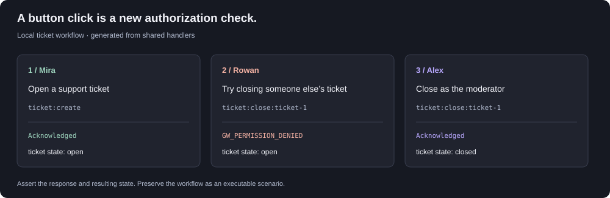

# discord-bot-kit

**Build and test Discord bots locally, with a workspace your coding agent can use.**

Run slash commands, buttons, modals and select menus against your actual handlers. Inspect the response lifecycle and state changes, capture a session as a test, then use the same bot definition with the included Discord adapter.

<p></p>

_An interaction trace generated from the actual handlers, illustrating the response and ticket state at each step. [Inspect the values](assets/ticket-walkthrough.json) or reproduce it with `npm run docs:demo`._

**Node 22.12+ · TypeScript · CLI + MCP · MIT**

[Quickstart](#try-the-ticket-workflow) · [Build your bot](#start-a-bot-you-can-edit) · [Agent integration](#give-your-agent-a-testable-task) · [API](docs/API.md) · [Discord setup](docs/DISCORD_SETUP.md)

## Try the ticket workflow

```bash
git clone https://github.com/owenawsong/discord-bot-kit.git
cd discord-bot-kit
npm ci
npm run dev
```

Open **http://127.0.0.1:18874**. No Discord token or AI account is needed locally.

1. Run `/ticket` and submit the modal.
2. Switch to **Rowan · Other member** and try **Close ticket**. The handler rejects it; inspect the diagnostic and unchanged ticket state.
3. Switch to **Alex · Moderator** and close it successfully.
4. Select **Turn session into a test**, review the inferred assertions, and run the scenario against fresh state.

The conversation, event timeline, state differences and execution history stay together. **Bot contract** exposes commands, options, permissions, component routes and state schemas. **Test scenarios** accepts editable JSON and reports concrete assertion failures.

## Start a bot you can edit

From the built checkout, scaffold into a new directory:

```bash
node dist/src/cli.js init ../my-bot --recipe polls
cd ../my-bot
npm install
npm test
npm run playground
```

The starter includes `bot.mjs`, executable scenarios, `.env.example`, deployment instructions and an `AGENTS.md` for coding assistants. Its dependency points to your clone. To move it to another machine, build a tarball with `npm pack` and pass its absolute path to `init --package /path/to/package.tgz`. The quickstart does not assume an npm publication.

| Starter           | What it implements                                        | What its tests exercise                                                  |
| ----------------- | --------------------------------------------------------- | ------------------------------------------------------------------------ |
| **Tickets**       | Support modal, channel reservation and authorized closure | Concurrent requests, forbidden clicks and ambiguous creation recovery    |
| **Event signups** | Event creation, join/leave, capacity and closure          | Duplicate joins, competing final places and stale components             |
| **Polls**         | Subcommands, embedded cards, voting and autocomplete      | Changed votes, concurrent updates, ownership and custom persistent state |

Choose `--recipe tickets`, `signups` or `polls`. You can inspect the other recipes directly with `node dist/src/cli.js playground --recipe polls --port 18876` or `--recipe signups --port 18875`. [Poll walkthrough →](docs/POLLS.md)

## Give your agent a testable task

> Read AGENTS.md. Add a command that privately shows a member's vote. Test a member with no vote and one after voting. Run the scenarios, inspect the evidence and show the result in the local workspace.

The [agent skill](skills/discord-bot-kit/SKILL.md) documents this loop. The [stdio MCP server](docs/API.md#mcp-local-stdio) exposes inspection, interaction simulation, scenarios, autocomplete, state and reset. Its tools operate locally; live registration and connection use explicit CLI commands.

Handlers use the same contract for local and Discord execution:

```js
import { defineBot } from "@owenawsong/discord-bot-kit";

export default defineBot({
  name: "My bot",
  routes: [],
  commands: [
    {
      name: "hello",
      description: "Welcome a member",
      handler: async (ctx) => {
        await ctx.reply({ content: "Welcome aboard.", ephemeral: true });
      },
    },
  ],
});
```

Typed options, choices, bounds, subcommands/groups, autocomplete, embeds and component handlers are included. [API reference →](docs/API.md)

## Keep behavior as executable evidence

JSON scenarios support captured IDs, typed references, exact/absent path assertions, parallel batches and simulated faults. Failures exit nonzero with actual results and remedies. There is no model judge deciding whether a test passed.

```json
{
  "name": "Create and close a ticket",
  "steps": [
    {
      "name": "ticket:create",
      "kind": "modal",
      "fields": { "topic": "Need help" },
      "saveAs": "created",
      "expect": { "clean": true, "ticketCount": 1 }
    },
    {
      "name": "ticket:close:${created#/state/tickets/0/id}",
      "kind": "button",
      "expect": {
        "clean": true,
        "exact": { "/state/tickets/0/status": "closed" }
      }
    }
  ]
}
```

Inside a generated project:

```bash
npm exec -- discord-bot-kit test --bot bot.mjs --scenario scenario.json --out evidence.json
npm exec -- discord-bot-kit replay --bot bot.mjs --evidence evidence.json
```

Replay restores validated initial state in an isolated simulator. Evidence includes inputs, events, diagnostics and state. Definition fingerprints cover registered function text and metadata; retain source versions because imported dependencies and closure values are outside that fingerprint. [Scenario reference →](docs/SCENARIOS.md)

## Store your bot's own domain data

Declare a versioned JSON namespace with an initial value and validator. `ctx.state(name)` is guild-scoped by default; global scope is explicit. Transactions serialize within one process, validate before writing and return detached copies. Invalid mutations roll back, and schema mismatches preserve the file for an explicit migration.

The poll starter is implemented entirely through this public API. [Namespace examples and storage guarantees →](docs/STATE.md)

## Verification and limits

```bash
npm run check
npm pack
```

**68 library tests and 33 bundled recipe scenarios** cover lifecycle handling, authorization, typed arguments, concurrency, persistence, namespace isolation, fault recovery, replay, embeds, autocomplete, HTTP/MCP boundaries and rename compatibility. CI runs Node 22/24 on Windows and Linux, including fresh installs of all three starters.

The workspace simulates interactions; actual gateway behavior, permissions, rate limits, network timing and Discord rendering need a real test guild. Local timings measure handler execution. The adapter is implemented and type-checked; **authenticated live-guild verification remains pending**. [Test-guild procedure →](docs/DISCORD_SETUP.md)

Trusted bot handlers run as Node code. The JSON store supports one process per file; replicated deployments need shared transactional storage. Live state and evidence can contain personal data. Registration requires explicit `--apply` and replaces the configured application's guild command list.

Previously called Guildwright? Old state paths, evidence, session headers and complete channel markers remain supported. [Migration guide →](docs/MIGRATION.md)

## Contribute

A useful contribution starts with a real bot workflow and a scenario that demonstrates its failure. Recipes should exercise ownership, concurrency and recovery alongside the happy path.

[Contributing](CONTRIBUTING.md) · [Security](SECURITY.md) · [Changelog](CHANGELOG.md) · [Launch kit](docs/LAUNCH.md) · [MIT](LICENSE)

Built by [Owen Song](https://github.com/owenawsong), a student developer. Independent project; not affiliated with Discord.
