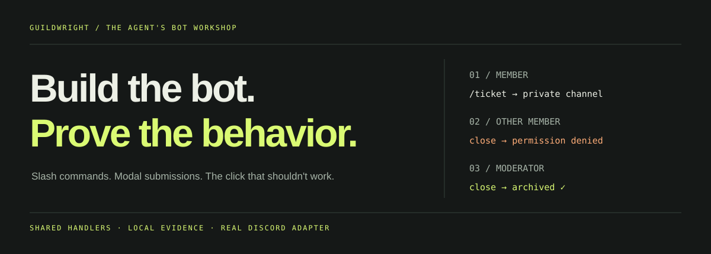
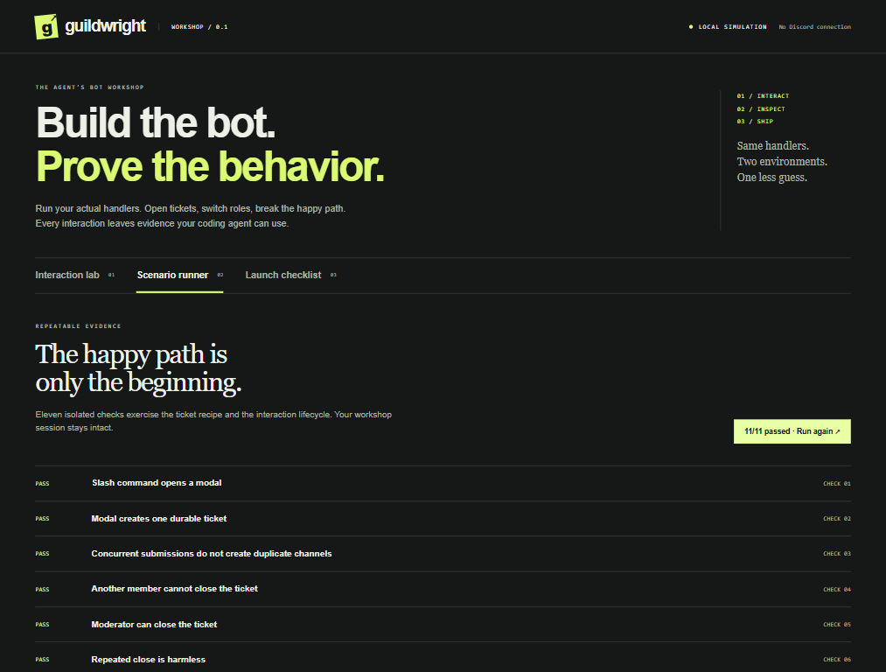

<p align="center"></p>

<p align="center"><strong>A local Discord development workshop for the coding agent you already use.</strong><br>Run the actual handlers. Inspect the consequences. Ship with evidence.</p>

<p align="center"><a href="#open-the-workshop">Open the workshop</a> · <a href="#give-your-agent-a-working-loop">Agent workflow</a> · <a href="docs/API.md">API & scenarios</a> · <a href="docs/DISCORD_SETUP.md">Connect to Discord</a></p>

An agent can generate a bot that compiles. Does another member's button bypass its permissions? Does a slow handler miss the interaction deadline? Do eight simultaneous ticket submissions create eight channels?

**Guildwright makes those questions executable.** One handler implementation runs in an interactive local playground and through a discord.js production adapter. Your agent gets actual replies, lifecycle events, diagnostics and durable state—not a second mock implementation of the bot.

## Open the workshop

Requires **Node 22.12+**. No Discord token, AI subscription or external service is needed locally.

```bash
git clone https://github.com/owenawsong/Guildwright.git
cd Guildwright
npm ci
npm run dev
```

Open **http://127.0.0.1:18874**. Choose `/ticket`, submit the modal, switch to **Rowan / Other member**, and try closing Mira's ticket. Inspect the permission diagnostic and unchanged state. Switch to the moderator and close it successfully. Run the scenario suite from the second tab.

<p align="center"></p>

## What is included

| Capability | What you can actually do in v0.1 |
| --- | --- |
| Interaction lab | Run slash commands; click buttons; submit modals; choose select options |
| Slash options | Strings, numbers, integers, booleans, user/channel IDs; required values, choices and bounds |
| Actor switching | Exercise member, other-member and moderator fixtures; try DMs and expired arrivals |
| Lifecycle diagnostics | Catch double responses, missed acknowledgement deadlines and unacknowledged handlers |
| Ticket recipe | Reserve before creation, authorize every close, avoid concurrent duplicates, recover existing channels |
| Event signup recipe | Durable capacity, join/leave, duplicate prevention, closed rosters and ordered component updates |
| Scenario runner | Assert replies, diagnostic codes, events and ticket state; fail CI with concrete evidence |
| Agent tools | CLI plus stdio MCP for inspect, simulate, test and reset |
| Live adapter | discord.js gateway transport, private channel creation, guild command registration preview |
| Evidence | Inspect execution JSON; download session evidence; retain restart-safe ticket records |

**Tickets and event signups are complete included recipes.** The notification selector in the ticket demo demonstrates validation; it is not a notification service. Moderation and AI chat recipes are future work.

Try the second recipe without scaffolding:

```bash
node dist/src/cli.js playground --recipe signups --port 18875
node dist/src/cli.js test --recipe signups --json
```

Switch to **Alex / Moderator**, run `/event-create`, and enter a title and capacity. Join as Mira, then Rowan. Try duplicate joins, a full event, leaving, and a stale button after closure. The same option schema powers the local form, validation and Discord command registration.

## Give your agent a working loop

Create a bot in a **new directory**:

```bash
node dist/src/cli.js init ../my-support-bot
cd ../my-support-bot
npm install
npm test
npm run playground
```

Use `init ../my-event-bot --recipe signups` for the signup starter. Both starters include a matching scenario and deployment configuration.

The scaffold includes `bot.mjs`, `scenario.json`, `.env.example`, deployment instructions and focused `AGENTS.md` guidance. Its dependency points to your local clone; no unpublished npm package is assumed. For a portable installation, run `npm pack` in Guildwright and pass the absolute `.tgz` path using `init --package /path/to/package.tgz`.

Give your agent a task:

> Read AGENTS.md. Add a /hello command that replies privately. Add a scenario proving the response. Run the scenarios and inspect the workshop. Report what passed. Do not connect to Discord yet.

```js
import { defineBot } from '@owenawsong/guildwright';

export default defineBot({
  name: 'My bot',
  commands: [{
    name: 'hello', description: 'Welcome a member',
    handler: async ctx => {
      await ctx.reply({ content: 'Welcome aboard.', ephemeral: true });
    }
  }],
  routes: []
});
```

Inside the scaffold, use `npm exec -- guildwright inspect --bot bot.mjs` for additional CLI commands. For custom bots use explicit scenario files: `npm exec -- guildwright test --bot bot.mjs --scenario scenario.json --json`. Without `--scenario`, the selected recipe's bundled suite runs. In this source checkout, the equivalent executable is `node dist/src/cli.js`.

Prefer MCP? [Configure the local stdio server](docs/API.md#mcp-local-stdio). Its tools only simulate locally; they cannot register commands or connect to Discord.

## A failure your agent can fix

```text
GW_DOUBLE_ACK
This interaction already has an initial response.
After defer(), use edit(); after reply(), use followup().
```

Every execution returns structured inputs, events, diagnostics with remedies and a state snapshot. Assertions compare actual behavior; there is no AI judge declaring its own work successful.

## Verification

```bash
npm test                         # core, persistence and HTTP boundary tests
node dist/src/cli.js test --json # 11 ticket scenarios
node dist/src/cli.js test --recipe signups --json # 14 signup scenarios
npm pack --dry-run              # inspect distributable package contents
```

Checks include unauthorized components, guild scoping, concurrent ticket submissions and event joins, corrupt state, restart persistence, argument types/bounds, response lifecycle, malformed MCP requests and cross-origin mutation rejection. CI runs Node 22/24 on Linux and Windows and exercises both scaffold recipes.

## Where simulation ends

The workshop is an approximation of interaction behavior, **not a Discord emulator**. It does not reproduce gateway events, actual permission overwrites, Discord rendering, rate limits, network timing or attachments. The measured time is local handler time, not Discord end-to-end latency. Flat slash options are supported; subcommands, autocomplete, resolved user/channel objects, voice and message events are not included yet. User/channel arguments expose IDs; validate resource permissions in the handler.

The live adapter is implemented and type-checked against discord.js. Authenticated real-guild integration still needs verification with your application; no live Discord account was used during release preparation. [Follow the test-guild procedure](docs/DISCORD_SETUP.md) before inviting users.

The JSON store supports one process per file. Replica deployments need transactional shared storage. Live state and exported evidence can contain personal data; keep them private. Public registration always requires an explicit `--apply`, which replaces the configured application's test-guild command list.

## Project

[API reference](docs/API.md) · [Agent workflow](docs/AGENT_WORKFLOW.md) · [Contributing](CONTRIBUTING.md) · [Security](SECURITY.md) · [Changelog](CHANGELOG.md)

Built by [Owen Song](https://github.com/owenawsong). Independent project; not affiliated with Discord. **MIT licensed.**
